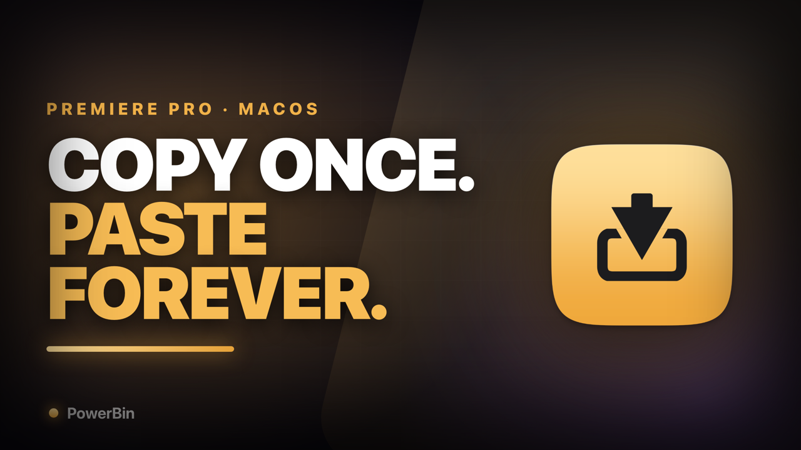

# PowerBin for Premiere Pro



**Copy once. Paste forever.** PowerBin is a free, open-source macOS menu-bar app that saves
anything you copy in Adobe Premiere Pro (clips, lower thirds, adjustment layers, effect
stacks, SFX stacks, nested sequences) as a named preset, and pastes it back into any project
from a floating panel that opens under your mouse.

> **Status: unmaintained, last tested on Premiere Pro 2025 (v25).** Premiere has shipped
> several releases since. It may still work, it may not. Read
> [KNOWN_ISSUES.md](KNOWN_ISSUES.md) before you build it, and please open an issue with
> your Premiere version if you try it.

**How to use it:** the [user guide](docs/USER_GUIDE.md) covers setup, saving, pasting, paste
modes, workspaces and troubleshooting, with the caveats for each step.

## The problem it solves

Premiere has no real "snippet library". Every editor ends up with the same workaround: a
template project full of lower thirds, transitions, title cards and grade stacks, which you
open, find the thing in, copy, switch back, and paste. Every time.

PowerBin turns that into: hotkey → double-click → it's on your timeline.

Good fits:

- **Freelancers juggling clients.** One workspace per client, each with its own lower
  thirds, logo bugs, captions styles and end cards.
- **Repeated timeline building blocks.** SFX whoosh stacks, adjustment layer + grade,
  zoom-punch-in keyframes, caption templates, intro/outro sequences.
- **Anything you would otherwise keep in a "template" project** and copy out of by hand.

## What the demo video shows

The ~45 second demo walks through the full round trip, silent, in six shots:

| # | What you see | Why it matters |
|---|---|---|
| 1 | Premiere timeline is open. Press the hotkey (⌃⌥⌘P) and the PowerBin panel appears under the cursor, over the timeline. Premiere never loses focus. | The whole product in one frame. |
| 2 | **Save:** select 3-4 clips → ⌘C → hotkey → **Save** → name it "Lower third — client A". It appears at the top of the list. | Capturing a preset is two keystrokes. |
| 3 | **Paste:** open a *different* project → hotkey → click the preset → ⌘V. The clips land on the timeline. | Reuse across projects, which Premiere can't do on its own. |
| 4 | **Workspaces:** click a second client workspace in the sidebar, the list swaps to that client's presets, click back. | Keeps per-client libraries separate. |
| 5 | **Quick access:** the ⭐ Favorites rail and the 📊 Most Used rail, with counts and thumbnails. | The library stays usable past ten items. |
| 6 | Press ⎋. The panel vanishes and Premiere is exactly where it was. | It stays out of your way. |

## Features

- **Floating panel at the mouse.** A non-activating `NSPanel` (Raycast/Spotlight style), so
  Premiere keeps focus.
- **Premiere-only hotkey.** The global shortcut is ignored unless Premiere Pro is frontmost
  (toggle in Preferences).
- **Mouse-button friendly.** Map a mouse button to `F13`-`F20` in Karabiner-Elements and
  record it as the hotkey; no modifier needed.
- **Three paste modes.** `Native ⌘V` (default), `Excalibur` (sends your Excalibur shortcut
  after loading), or `Custom` (any recorded combo).
- **Auto-paste.** After loading a preset, PowerBin brings Premiere forward and sends the
  paste keystroke for you (needs Accessibility).
- **Client workspaces.** Create, rename, switch and delete libraries from the panel.
- **Preview thumbnails.** Upload a screenshot, capture one, or use one already on the
  clipboard, so you can see what a preset is before pasting it.
- **Favorites, Most Used, sorting** by date, name, size or clipboard type count.

## How it works

When you copy in Premiere, it puts its data on the macOS pasteboard under private Adobe
types (`com.adobe.*` and dynamic `dyn.*` UTIs). PowerBin snapshots every type on the
pasteboard, stores them as base64 blobs in a JSON `.clp` file, and writes them all back
when you load the preset. Premiere then sees exactly what it put there and pastes it.

PowerBin never reads or edits your project file, and it makes no network requests.

Presets live in `~/Library/Application Support/PowerBin/workspaces/<workspace>/presets/`.
The log lives in `~/Library/Logs/PowerBin.log` (mode `0600`, capped at 1 MB; it contains
preset and workspace names).

## Requirements

- macOS 13 Ventura or later, Apple Silicon or Intel
- **Full Xcode** to build (see [KNOWN_ISSUES.md](KNOWN_ISSUES.md#build); Command Line Tools
  alone fail on current macOS SDKs)
- Adobe Premiere Pro (last tested: 2025 / v25)

There are no prebuilt, notarized downloads. Build it yourself.

## Build

```bash
git clone https://github.com/adi-1108/powerbin-premiere-pro.git
cd powerbin-premiere-pro
CONFIG=release bash Scripts/build-dmg.sh   # → dist/PowerBin.app + dist/PowerBin-<ver>.dmg
```

`build-dmg.sh` builds a universal (arm64 + x86_64) binary with SwiftPM, assembles the `.app`
bundle by hand, signs it, and wraps it in a DMG. `CONFIG=debug` builds a native-only
"PowerBin Mac Test" bundle that installs beside the release one.

Prefer Xcode? Generate a project with [XcodeGen](https://github.com/yonaskolb/XcodeGen):

```bash
brew install xcodegen
xcodegen generate
open PowerBin.xcodeproj
```

### Signing and Accessibility

macOS ties the Accessibility grant to the app's code signature. An ad-hoc signed build
(the fallback) gets a new identity on every rebuild, so macOS asks for Accessibility again
each time. To avoid that, create a self-signed code-signing certificate in Keychain Access
and pass its name:

```bash
POWERBIN_LOCAL_SIGNING_ID="My Local Code Signing" CONFIG=release bash Scripts/build-dmg.sh
```

If a `Developer ID Application` certificate is in your keychain, the script uses it
instead (needed only if you want to notarize and hand the app to other people).

## First run

1. Move `PowerBin.app` to `/Applications` and open it. It has no Dock icon; look for the
   tray icon in the menu bar.
2. Grant **Accessibility** (System Settings → Privacy & Security → Accessibility). Needed
   for auto-paste. Grant **Input Monitoring** too if the Permissions window asks for it.
3. Switch to Premiere. Press ⌃⌥⌘P: the panel opens at the mouse.
4. In Premiere, select something and press ⌘C → hotkey → **Save** → give it a name.
5. Later, in any project: hotkey → double-click the preset → it pastes (or press ⌘V
   yourself if auto-paste is off).

### Karabiner mouse buttons

1. In Karabiner-Elements, map a mouse button to a function key such as `f13`.
2. In PowerBin Preferences, click the hotkey field and press that mouse button once. It
   should record as `F13`.
3. Pressing the button now toggles the panel under the pointer.

## Settings

| Setting | What it does |
|---|---|
| Hotkey | The combo that toggles the panel. Default ⌃⌥⌘P. |
| Premiere-only hotkey | On by default: the hotkey does nothing unless Premiere is frontmost. |
| Paste mode | `Native ⌘V`, `Excalibur`, or `Custom`. |
| Auto-paste | Bring Premiere forward and send the paste keystroke after loading. |
| Premiere bundle ID | Empty = auto-detect any running `com.adobe.PremierePro*`. Set it only if detection fails. |
| Show in Dock | Off by default (menu-bar only). |

## Project layout

```
Sources/PowerBinPersonal/
  PowerBinApp.swift        @main, AppDelegate, menu-bar item, panel + hotkey wiring
  FloatingPanel.swift      NSPanel subclass, positions at the mouse
  HotkeyService.swift      Carbon hotkeys + Karabiner-friendly F-key fallback
  PasteboardService.swift  NSPasteboard snapshot / restore, Adobe type filtering
  PasteDriver.swift        Finds and activates Premiere, injects the paste keystroke
  PresetStore.swift        Workspaces and .clp presets on disk
  PresetUsageStore.swift   "Most used" counts
  PreviewImageCache.swift  Thumbnail cache
  PermissionsService.swift Accessibility / Input Monitoring checks
  Settings.swift           UserDefaults-backed settings
  Views/                   SwiftUI: RootView (panel), SettingsView, PermissionsView, ...
Scripts/
  build-dmg.sh             Build, bundle, sign, package
  make-icon.sh             Regenerate Resources/PowerBin.icns from the SVG
Tests/                     XCTest (needs Xcode)
```

## Contributing

Issues and pull requests are welcome, especially:

- **Compatibility reports.** Use the bug report template and include your Premiere Pro
  version, macOS version, and what you copied. "Works on Premiere 26.x" is useful too.
- Fixes for anything in [KNOWN_ISSUES.md](KNOWN_ISSUES.md).

Keep changes small and native (AppKit / SwiftUI, no third-party dependencies).

## License

[MIT](LICENSE). Not affiliated with or endorsed by Adobe. Adobe and Premiere Pro are
trademarks of Adobe Inc.
